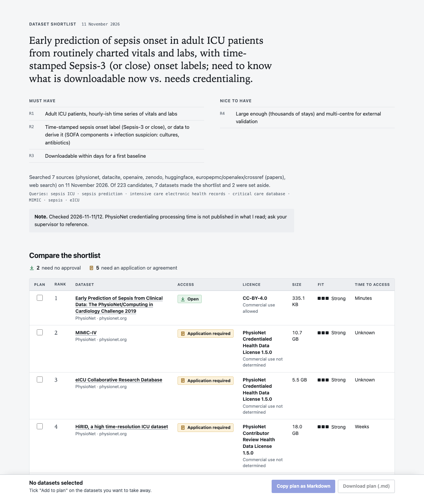
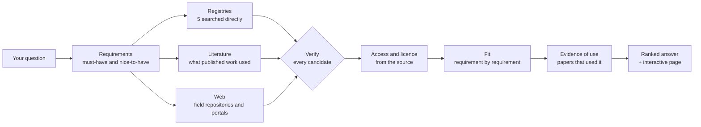

# dataset-shortlist

**Find research data you can actually get.** See it run: <https://wangnicolas.github.io/dataset-shortlist/>

`dataset-shortlist` is an agent skill for Claude Code. Tell it what you want to study
and it comes back with a short list of datasets, each checked against its
registry record or landing page where one could be reached: how it is obtained,
what its licence permits, whether it contains what your question needs, and
papers that used it. Every fact is marked as checked today or recalled. A run that completes the workflow also writes
one interactive page where you compare the candidates, filter them, tick the
ones you want and take away an access plan.



*A page the skill wrote for one of its four development questions (early sepsis
prediction in intensive care), unedited. The pages for the held-out
questions, including the ones where little could be verified, are in
[`docs/examples/heldout/`](docs/examples/heldout/), rendered by the current version from the data each run recorded.*

```text
> I want to predict sepsis onset in adult ICU patients. What data can I start
  on this week, and what is worth applying for?
```

## Why

Ask an AI assistant which datasets exist for a topic and you get a fluent,
confident list. Three things tend to be wrong with it, and each costs days or
weeks:

- **Names and links that do not hold up.** In a 2026 study of research agents,
  3–13% of the URLs they cited were hallucinated and 5–18% did not resolve
  ([Rao, Wong and Callison-Burch](https://arxiv.org/abs/2604.03173); measured on
  citation URLs, not dataset links).
- **Only the famous few.** Across 1,000 computer-science papers, roughly four out
  of five of the datasets and metrics the papers used were not suggested by any
  of three language models, whose suggestions "cluster on well-known benchmarks"
  ([Carlon et al.](https://arxiv.org/abs/2606.26130); pipeline estimates).
- **"Publicly available" that is not.** The most valuable research data often
  needs training, an application, a signed agreement or an institutional
  signature. A fluent answer rarely says so, and the licence shown on a hosting
  site is itself often missing or wrong: an audit of widely used dataset hosting
  sites found "license omission of 70%+ and error rates of 50%+"
  ([Longpre et al.](https://arxiv.org/abs/2310.16787)).

These studies are adjacent evidence. We found none that measures invented
datasets or wrong access claims directly, which is one reason this project
measures them itself.

`dataset-shortlist` is built around preventing those three. It is a verification
layer over existing registries, not a new search engine.

It also avoids the opposite mistake. A model that is told to go and check tends
to report only what it managed to confirm and to drop what it already knew. The
skill keeps what the model knows, adds what the registries and the literature
know, and marks every fact by how it is known: confirmed today from a named
source, or recalled and not confirmed.

## What it does



| Step | What happens | Why it matters |
|---|---|---|
| Requirements | The question becomes a short list of must-haves: population, modality, the outcome or label, scale, access constraints. | Everything later is checked against it. |
| Search | Five registries are queried side by side, the literature is searched for what published work used, and field portals are searched on the web. | Gets past the datasets everyone already knows. |
| Verify | Each candidate is checked through its registry's own record, its DOI, or its landing page. What could not be confirmed today is kept and marked as recalled. | A candidate that cannot be found is flagged instead of being passed on as fact, and you can tell a checked fact from a remembered one. |
| Access and licence | The access condition comes from registry metadata or the landing page, in plain words: direct download, free account, application, institutional agreement, not obtainable. Each fact is marked as confirmed today or recalled. | You know what you can start on today, and which statements to double-check. |
| Fit | Each requirement is marked met, partly met, not met or unknown, with the evidence. | A dataset on the right topic without the label you need is not a candidate. |
| Evidence of use | One to three papers that used the dataset for a similar purpose. | A baseline, a citation, and proof the data is workable. |

Registries searched directly: OpenAIRE, DataCite, Zenodo, Hugging Face Hub and
PhysioNet. For everything else the skill carries a map of which repositories
hold which kind of data and searches them with the agent's web tools.

For health and biomedical data the skill goes further: credentialing, training
and data use agreements are spelled out, and it knows that many agreements
restrict passing records to online AI services.

## Install

In a terminal:

```bash
claude plugin install dataset-shortlist --marketplace wangnicolas/dataset-shortlist
```

This one command adds the repository as a marketplace and installs the plugin (Claude Code 2.1.292 or newer).
Start Claude Code afterwards, or run `/reload-plugins` in a session that is already open. On an older version, or
from inside Claude Code, use the two steps instead: `/plugin marketplace add wangnicolas/dataset-shortlist`, then
`/plugin install dataset-shortlist@dataset-shortlist-marketplace`.

Then ask your question in plain words. The skill needs Python 3.9 or newer and
outbound HTTPS. It uses no packages and needs no API key. When idle it adds about
210 tokens to a session; when it starts it loads about 4,600 (estimates from
`claude plugin details` for version 0.1.2).

To try it from a clone for one session, with nothing installed:

```bash
claude --plugin-dir plugins/dataset-shortlist
```

The skill works by running its own script (`scripts/scout.py`) many times per
question, plus web searches and page reads. Claude Code asks before running a
shell command unless your permission settings already allow it, so expect those
prompts, or allow the script for the session.

Optional: the literature search uses OpenAlex first, which gives users without a
key a small daily allowance shared by everyone on the same network address. A
free key from <https://openalex.org/settings/api>, set as the environment
variable `OPENALEX_API_KEY`, raises it. Without one the skill falls back to
other sources.

The skill follows the open Agent Skills format, so other agents that load
`SKILL.md` folders should be able to use it (tested only in Claude Code): copy
`plugins/dataset-shortlist/skills/dataset-shortlist/` into the agent's skills directory.

## Does it beat Claude without the skill?

<!-- RESULTS:START written by tools/fill_readme.py from the run records; do not edit by hand -->
**Result.** Ten sealed questions, Sonnet 5.5 (claude-sonnet-5-5), three runs per arm, 12 November 2026. By the rule fixed before the run:

> **Mixed: the per-question table is the result.**

The rule's three conditions for "beats": a mean gain of 5 points or more, met (+9.6); a higher score on at least 7 of the 10 questions, not met (6); no stratum lower, met.

Mean case score 90.7% with the skill and 81.0% without it, a difference of +9.6 points (each repeat on its own: +8.5, +5.4, +15.0). The skill scored higher on 6 of the 10 questions, the same on 2 and lower on 2.

1 of the verdicts is a failed call to the judge, recorded by the evaluation tool as a fail (1 in the arm with the skill). Nothing was judged again. Counted as a pass instead, the scores are 91.1% with the skill and 81.0% without it (difference +10.0 points; higher on 6 questions, the same on 2, lower on 2). Against the arm told to verify the difference would then be +6.6 points (higher on 6, the same on 3, lower on 1).

Against Claude without the skill but told to search the web and verify: 90.7% with the skill and 84.5% without, a difference of +6.2 points; higher on 6 questions, the same on 2, lower on 2.

|  | With the skill | No skill | No skill, told to verify |
|---|---|---|---|
| Mean case score: health (6 questions) | 92% | 86% | 88% |
| Mean case score: other fields (4 questions) | 89% | 73% | 79% |
| Links per answer | 8.0 | 0.0 | 11.3 |
| Links that resolve | 217 of 241 | none given | 278 of 338 |
| Dead links | 4 | 0 | 22 |
| Time per answer | 2.9 min | 0.5 min | 0.9 min |
| List-price cost per answer | $0.44 | $0.07 | $0.35 |

A case score is the share of a question's content checks that passed, averaged over its runs. Differences are computed before rounding, so they can differ by a tenth from the difference of the rounded figures. Dates are in Japan time.

By kind of check (share passed):

| Check | Questions | With the skill | No skill | No skill, told to verify |
|---|---|---|---|---|
| Found the suitable datasets | health | 100% | 100% | 90% |
| Found the suitable datasets | other fields | 89% | 81% | 83% |
| Stated how to obtain them correctly | health | 86% | 73% | 82% |
| Stated how to obtain them correctly | other fields | 83% | 63% | 73% |
| Avoided the unsuitable famous one | health | 100% | 100% | 100% |
| Avoided the unsuitable famous one | other fields | 100% | 100% | 100% |
| Surfaced a less-known fitting dataset | health | 72% | 72% | 83% |
| Surfaced a less-known fitting dataset | other fields | 92% | 50% | 58% |

Pooled over all questions: access conditions stated correctly 85% with the skill against 69% without; a less-known fitting dataset surfaced 80% with the skill against 63% without; the suitable well-known datasets found 96% with the skill against 93% without; the unsuitable famous dataset avoided 100% with the skill against 100% without.

How far the 30 with-skill runs went through the workflow: registry search 30, literature search 29, verifier 27, interactive page 16. In the 14 runs without a page, 14 answers say that it was not built and 0 point to a page that does not exist.

Blind audit of the two main arms. For one answer per question and arm (the first run), an auditor on a different model looked up the official page of every dataset the answer recommends. It was not told which arm wrote which answer, but the answers differ visibly, so the blinding is by label only. Each share leaves out the items the auditor could not settle (a page that could not be reached, no access condition stated, documentation that does not say):

|  | Datasets audited | Exist as described | Access stated correctly | Meet the must-haves |
|---|---|---|---|---|
| With the skill | 83 | 99% (80 of 81) | 93% (65 of 70) | 90% (63 of 70) |
| No skill | 76 | 100% (75 of 75) | 90% (54 of 60) | 94% (61 of 65) |

The skill marks each access statement as confirmed today or recalled. The marking carries information: 39 of 40 statements marked as checked today were right, against 26 of 30 marked as recalled.

The audit and the checks measure different things. The audit asks whether what an answer says about a dataset is right. The access checks ask whether the answer states the particular facts a researcher needs in order to decide. An answer can be right in what it says and still leave those facts out.

<details>
<summary>Every question, including the ones where the skill did not help</summary>

| Question | Stratum | With the skill | No skill | No skill, told to verify | Skill minus no skill, points |
|---|---|---|---|---|---|
| Checkpoint-inhibitor response from tumour RNA-seq (`ho-h-checkpoint-response-rnaseq`) | health | 100% | 100% | 100% | 0 |
| Chest X-rays with free-text reports (`ho-h-cxr-free-text-reports`) | health | 92% | 88% | 96% | +4 |
| Skin images with skin-tone labels (`ho-h-derm-skin-tone`) | health | 90% | 67% | 100% | +24 |
| 12-lead ECGs with rhythm labels, no application (`ho-h-ecg-rhythm-labels`) | health | 89% | 93% | 67% | −4 |
| National surveys with measured blood pressure (`ho-h-measured-bp-surveys`) | health | 79% | 75% | 67% | +4 |
| Wrist accelerometry linked to outcomes (`ho-h-wrist-activity-outcomes`) | health | 100% | 96% | 100% | +4 |
| Taxi GPS trajectories (`ho-o-01`) | other fields | 95% | 100% | 86% | −5 |
| Linked employer-employee microdata (`ho-o-02`) | other fields | 96% | 75% | 88% | +21 |
| Meeting recordings for diarization, commercial use (`ho-o-03`) | other fields | 75% | 75% | 67% | 0 |
| Galaxy images with human morphology labels (`ho-o-04`) | other fields | 90% | 43% | 76% | +48 |

</details>

On Opus 5.5 (claude-opus-5-5), the ten questions, three runs per arm, 12 November 2026: 97.4% with the skill and 91.8% without it, a difference of +5.6 points; higher on 5, the same on 4, lower on 1.

On that model an answer with the skill took 5.8 minutes and $1.28 at list price, against 1.0 minutes and $0.27 without it, and carried 12.5 links against 3.4.

On Fable 5.2 (claude-fable-5-2), the ten questions, two runs per arm, 11 and 12 November 2026: 97.5% with the skill and 90.0% without it, a difference of +7.5 points; higher on 4, the same on 6, lower on 0.

2 of the verdicts are failed calls to the judge, recorded by the evaluation tool as fails (2 in the arm without the skill). Nothing was judged again. Counted as passes instead, the scores are 97.5% with the skill and 91.4% without it (difference +6.1 points; higher on 3 questions, the same on 7, lower on 0).

On that model an answer with the skill took 7.6 minutes and $3.79 at list price, against 1.6 minutes and $1.14 without it, and carried 22.2 links against 6.8.

Does it start when it should: each of 20 requests was sent once to a fresh session with only this plugin added. The skill started on 10 of 10 requests that ask for datasets and on 0 of 10 that do not.

What this does not show:

- The answer keys were built by Claude agents from published papers and official pages and re-checked on a different model. They were not written by human domain experts.
- The judge is a language model. Link checks are done by script.
- Famous datasets are known to every arm from training, so finding those measures little.
- Several access checks ask for an explicit statement of how the data is obtained. An answer that names a hosting site without saying whether an application is needed fails such a check.
- Ten questions is a small sample; the result is descriptive and no significance test is claimed.
- The web changes: access rules and links are those of the day of the run.

Run records, with every answer and every grader verdict: [`docs/eval/heldout_report.md`](docs/eval/heldout_report.md).
<!-- RESULTS:END -->

### How it was measured

The evaluation ran on the 0.1 series of the skill, under the working name
`dataset-scout`; the run records in `eval-runs/` and the pages in
`docs/examples/` keep that name, and `CHANGELOG.md` lists what each release
changed.

The comparison is defined in [`docs/EVAL_PROTOCOL.md`](docs/EVAL_PROTOCOL.md),
written before any result existed:

- The same model answers the same question in fresh, isolated sessions in three
  arms: with the skill, without it, and without it but told to search the web
  and verify. All arms have web search, page fetching and a shell.
- One primary outcome and the rule for what will be said about it were fixed
  before the held-out run.
- Gold answers come from published papers and official pages, built by agents
  that never saw the skill. The held-out questions were sealed until the skill
  was frozen.
- Graders test content only: were the suitable datasets found, are the access
  facts right, was an unsuitable famous dataset avoided, was a less-known fitting
  dataset surfaced. Link validity is checked by script, and for one answer per
  question and arm the datasets it recommends are audited by a second model that
  is not told which arm wrote the answer.
- Every run is reported, including the cases where the skill is worse.

Reproduce it:

```bash
tools/run_eval.sh evals-heldout eval-runs/my-run --model sonnet --runs 3 -j 3
```

These are real, billed model runs; the records state what each run cost. The
held-out questions are now published with the results, so they are spent: the
next version needs a new set.

## Limits

- It finds and checks; it does not download data or apply for access on your
  behalf.
- Access conditions and licences change. Every answer carries the date of the
  check; check again before you rely on it.
- Registry metadata can be wrong. A licence chosen by an uploader is a claim.
  The skill reads landing pages when the record is silent, and says "not
  confirmed" when it could not establish a fact.
- Coverage is uneven. The five registries are searched systematically; other
  repositories depend on web search. When a field keeps its data elsewhere
  (sequence archives, national survey portals, company data programmes) the
  skill falls back to web search and page reading, verifies less, and says so.
- The interactive page is not always written; when it is not, the answer says
  so. The evaluation above counts how often.
- Fit is judged from documentation, not from the data itself.
- It costs more time and money per answer than asking without the skill. The
  evaluation above gives both figures.

## How it is built

```text
plugins/dataset-shortlist/skills/dataset-shortlist/
  SKILL.md              the workflow the agent follows
  references/           where to search, access and licences, health data, page format
  scripts/scout.py      search, add, verify, lookup, papers, render
  scripts/scoutlib/     one adapter per registry, verifier, literature, renderer
  assets/               the page template
tests/                  offline tests with recorded registry responses
tools/                  evaluation runner, analysis, blind audit
docs/                   protocol, build specification, research notes, roadmap
```

Run the tests with `python -m pytest tests -q`. Adding a registry is one file in
`scripts/scoutlib/sources/`; `docs/SPEC.md` describes the interface.

## Prior art

This project stands on existing registries and on earlier work, which it does
not replace:

- [data-aggregator-mcp](https://github.com/musharna/data-aggregator-mcp) and
  [Mobus](https://github.com/mobus-ai/Mobus): multi-source dataset search with
  licence checks, as MCP servers.
- [DataFinder](https://github.com/viswavi/datafinder) and
  [DatasetResearch](https://github.com/GAIR-NLP/DatasetResearch): benchmarks for
  dataset recommendation.
- [karpathy/autoresearch](https://github.com/karpathy/autoresearch), for the
  idea that a research workflow can be programmed as a Markdown file an agent
  follows.

The survey behind these comparisons is in `docs/research/`.

## Roadmap

`dataset-shortlist` is the first stage of a larger plan to carry a research project
from a question to a result a reviewer can trust. See
[`docs/ROADMAP.md`](docs/ROADMAP.md).

## Licence

MIT.
